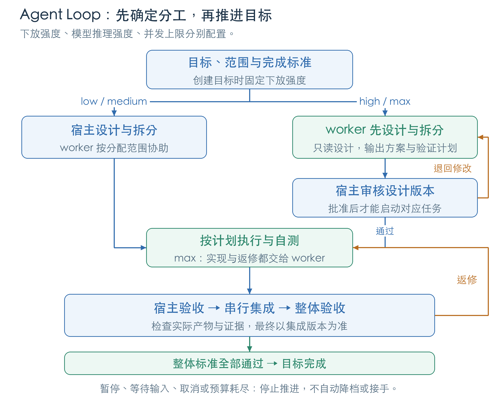
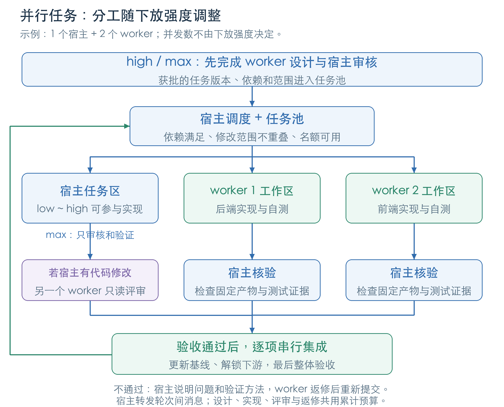

# 目标导向 Agent Loop

Loop 在单任务执行之上保存总目标、参与者、轮次、消息和验收证据。当前宿主 Agent 负责持续选择下一步，Bridge 执行每一轮并记录状态。可用于“实现 → 评审 → 返修 → 整体验收”。

面向使用者的配置与流程说明见 [Agent Loop 与并行任务](https://docs.google.com/document/d/1CZk0eO7RTbrD9ZVFUe3qW9Am_YJCWy8YYtcBrTR-Q1k/edit)。文档中的两张图与本页共用图源；在仓库根目录运行 `python3 scripts/draw-goal-diagrams.py` 可重新绘制，需要 Pillow 和中文字体。非 macOS 环境可通过 `DIAGRAM_FONT / DIAGRAM_BOLD_FONT` 指定字体文件。

```text
$agent-bridge:loop -d=max -w=claude -m=glm-5.3 -e=high 实现 <目标>，修改范围 <目录>，最多 8 个任务、3 次返修
```

模型、provider 和 endpoint 以实际发现与预检为准。首次授权覆盖的目的地、项目和范围内可以继续推进；创建目标、收到消息或保存预检记录都不增加授权。

## 下放强度和设计审核

`create_goal / create_parallel_goal` 接收可选的 `delegation_level`，聊天短参数为 `-d`。`low` 由宿主主导设计和实现；默认 `medium` 由宿主设计、worker 实现；`high` 先由 worker 设计，宿主可协助实现；`max` 将分析、设计、拆分、实现、自测和返修全部交给 worker，宿主只审核、提出修改要求、调度和独立验证。强度与 `effort`、并发上限分别配置，创建后固定。旧目标未记录该字段时按 `medium` 处理。

`high / max` 要求登记一个 `mode: "plan"` 的设计 worker。实现者另用 `mode: "edit"` 的参与者，可以使用同一运行时和模型，但不能把设计者的读取权限自动升级。宿主先明确用户目标、范围和完成标准，再让 worker 提出方案与任务图。worker 不自行派发其他 worker。



设计的提交与审核流程如下；所有步骤共用目标的累计预算。

1. 串行目标用 `advance_goal` 派发 `role: "design"` 的只读任务。并行目标先用 `plan_goal_tasks` 添加 `kind: "design", mode: "plan", task_contract.allowed_edits: []` 的任务，再由 worker 认领和执行。任务卡要求 worker 在结果中提供下文的结构化方案。
2. worker 结束后，宿主检查实际结果并用 `record_review` 验收设计任务。调用 `submit_goal_design`，传入 `goal / operation_id / source_job`；Bridge 从该已验收任务的 `result.md` 读取方案，保存不可变的 `design_fingerprint`。宿主不另外提交一份替代 worker 结果的方案。
3. 调用 `review_goal_design`，传入 `goal / operation_id / design_fingerprint / checks`。`checks` 使用整体目标的每个 `criterion_id`，但 `verification_kind` 均为 `source`，证据说明方案如何覆盖该标准；记录类型为 `design_coverage`。不通过时必须提供 `feedback`，每项包含 `criterion_id / problem / required_change / verification`。反馈绑定这份方案，worker 根据具体问题修改后重新提交，不能通过改写审核记录替代方案返修。
4. 获批后，串行 `advance_goal` 的任务同时提供 `role / design_task_id / design_fingerprint`，契约和范围与方案中的该任务一致；预检前把 `Approved design: <fingerprint>` 和 `Design task: <task_id>` 两行加入任务文本。并行 `plan_goal_tasks` 提供该 `design_fingerprint`，按原样登记获批任务；认领返回的 `design_context` 必须在 `prepare_dispatch` 前加入任务文本。声明来自旧版本的任务不能继续启动。
5. 方案变更前先结束并对账所有活动或状态未知的执行，完成待集成操作。新方案保留已经集成的产物；并行修订使用新的任务 ID，可依赖已集成任务。旧版本未集成任务在新方案获批后退出后续调度，记录和已消耗预算保留。不要直接改写已登记任务，或者另建目标清掉返修与无进展次数。

并行设计返修可以沿用同一设计任务卡，但必须等原 worker 确认结束后创建新的 attempt 和 job，仍消耗返修预算。设计依据派发时的源码，获批后的串行目标也会检查轮次间的源码连续性；目标执行之外的源码改动需要 worker 重新设计并获批。并行集成项目出现外部改动时会保留现场并拒绝继续，应先处理基线冲突。

worker 的输出必须包含且只包含一个 `agent-bridge-design` JSON 代码块，总输出不超过 120 KiB，Bridge 将完整方案保存到 `result.md`。字段为 `summary / decisions / validation_plan / tasks`；任务包含完整的标准 `task_contract`。例如：

````markdown
```agent-bridge-design
{
  "summary": "增加设置持久化，保留已有设置结构。",
  "decisions": ["沿用项目现有的设置存储入口。"],
  "validation_plan": ["验证保存、重启、读取以及缺省值行为。"],
  "tasks": [
    {
      "id": "settings-storage",
      "kind": "implement",
      "depends_on": [],
      "read_scope": ["src", "tests"],
      "mode": "edit",
      "task_contract": {
        "complexity": "standard",
        "context": "现有设置入口位于 src，相关测试位于 tests。",
        "allowed_edits": ["src/settings.mjs", "tests/settings.test.mjs"],
        "preserve": ["保留现有设置字段和缺省值"],
        "integration": "worker 实现与自测，宿主独立验证后集成。",
        "acceptance_criteria": [
          {
            "id": "settings-restart",
            "description": "设置保存后重新加载仍保留。",
            "verification": "运行设置持久化测试，覆盖保存、重新加载和缺省值。",
            "verification_kind": "test"
          }
        ]
      }
    }
  ]
}
```
````

方案中的任务 `kind` 为 `implement / research / review`；实现任务使用 `edit`，调研和评审使用 `plan`，评审任务可带 `review_of`。所有依赖、读取范围、修改范围和契约均受目标边界约束。设计任务也消耗步骤预算，返修累计计数，重复方案计入无进展；修改摘要、重启或恢复不能清零预算。方案审核只决定能否按该方案开工，不把整体测试或实际运行标准标记为通过；最终 `record_goal_review` 仍须使用原标准的验证类型检查集成后的代码。

`high / max` 的 `review_goal_task` 和 `record_goal_review` 如有失败或未验证项，同样必须逐项提供 `feedback`。任务反馈绑定对应产物指纹，整体反馈绑定源码快照；记录问题、要求和后续验证方法，让 worker 根据证据返修。宿主执行实际检查后才能更新验收结果。

`max` 允许宿主读代码、运行测试、处理调度和集成已验收产物；宿主认领的任务只能是 `kind: "review", mode: "plan"`，不允许认领设计、调研或实现任务。worker 受阻或预算耗尽时应报告原因与剩余工作，不自动降档、换模型或转为宿主接手。控制器约束 Bridge API 内的操作，Skill 指导宿主在外部工具中的行为；它不提供阻止宿主直接改文件的操作系统沙箱。

## 串行目标流程

1. 发现执行资源并预检目的地，定义整体完成标准、读写范围、固定参与者和有限预算。`create_goal` 保存目标，返回绝对 `goal` 路径。
2. 用 `read_goal_messages` 获取相关消息和上下文，在任务卡中选取本轮需要的信息，再调用 `prepare_dispatch`。消息必须在预检前加入，派发时不能更改绑定内容。
3. 通过 `advance_goal` 的 `dispatch` 或 `continue` 发起一轮，传入参与者、操作 ID 和完整预检参数。内部为该操作生成稳定 `request_id`，复用原有 Bridge 执行器。
4. `task_status` 等待任务结束；宿主独立检查并用 `record_review` 记录子任务验收。`goal_status` 对账任务状态，不调用模型。
5. 用 `send_goal_message` 转发问题、评审意见或证据；接收方在下一轮任务卡中获得相关内容。由另一个 Agent 评审时，前一个任务必须先结束。
6. 宿主获取当前源码快照指纹，执行整体目标的检查，再调用 `record_goal_review`。只有整体标准全部通过、子任务满足验收要求且没有未结束的执行，才完成目标。

## 工具

| 工具 | 用途 |
| --- | --- |
| `create_goal` | 创建目标；同 ID 同内容复用，改变内容拒绝 |
| `goal_status` | 读取目标、预算、步骤和源码快照，并对账已有任务 |
| `advance_goal` | 派发、续接、对账、暂停、恢复、取消、等待输入或更新上下文 |
| `send_goal_message` | 主控转发结构化消息，保存来源、回复关系与产物引用 |
| `read_goal_messages` | 按参与者和游标读取消息，生成用于下一轮任务卡的上下文 |
| `record_goal_review` | 保存整体目标的逐项证据，验证源码版本并决定验收状态 |
| `submit_goal_design` | 从本目标已验收的 worker 结果中读取并固定方案 |
| `review_goal_design` | 审核指定方案指纹，保存结构化修改要求并决定是否允许实现 |

创建目标需要 `goal_id`、`objective`、`context`、`read_scope`、`allowed_edits`、`acceptance_criteria`、`participants` 和 `limits`，可设置 `delegation_level`。参与者固定 `id / worker / provider / model / effort / endpoint / mode`，每轮还必须满足目标读写边界；`plan` 不能升级为 `edit`。例如实现者注册 `edit`、设计者和评审者注册 `plan`，分别绑定已发现的实际 GLM-5.3 配置。目标范围、参与者、标准、预算和下放强度创建后冻结。

每轮的 `execution` 使用现有派发参数，包括 `task_contract`、`prepared_ref` 和 `endpoint`；操作 ID 用于区分新工作和重复请求。`continue` 的任务必须已经关联到当前目标和参与者，并保持原任务契约及执行选择。

`advance_goal.action` 支持 `dispatch / continue / reconcile / pause / resume / cancel / wait_user / set_context`。`set_context` 接收 `summary / facts / decisions / open_questions`，保存递增的 `context_version`；共享上下文最多 24000 字节。读取消息使用 `recipient`、可选 `after_sequence` 与 `limit`，返回下一页 `cursor`。消息类型为 `question / answer / review / blocker / note`。

## 验收与停止

- 子任务的 `ready_for_review` 只表示执行返回。`record_review` 保存子任务证据，`record_goal_review` 另行验证整体目标。
- 目标验收绑定声明范围内实际文件内容，能够识别同大小修改、新文件及删除；`.ai` 和 `.git` 的变化不影响源码快照。超出遍历或大小上限会明确拒绝，不接受不完整快照。
- 验收前从 `goal_status` 获取 `snapshot_fingerprint`，在该版本上执行检查。检查过程中源码变化会拒绝旧指纹，完成后源码变化也会使验收失效。
- `max_steps` 限制累计派发尝试，包含设计、实现、评审和续接；例如 8 次表示这些执行合计最多 8 次，同一操作重放不增加次数，启动前被明确拒绝的尝试仍计数。`max_reworks` 统计续接、方案返修及整体失败验收后的新任务。`max_no_progress` 统计无进展轮次、重复方案和同一源码/检查结论的重复失败验收；证据改写不算进展。纯分析目标应按预期轮数配置该上限。消息、心跳、改写摘要和重启不能重置预算。
- 可选 `limits.timeout_seconds` 从创建起累计，暂停不会延长；`execution.timeout_seconds` 是独立的单任务预算。达到目标预算后阻止新执行，包括尚未创建任务的未决派发重放；已有任务和最终验收仍可收敛。若需要终止当前任务，单独使用任务时间预算或取消。
- 暂停保留正在运行的任务，取消会请求停止已有任务并保留部分修改。达到预算、等待输入或取消均不表示目标完成。

## 恢复与消息边界

目标保存在私有 `.ai/goals/<goal_id>/goal.json`，单任务仍使用 `.ai/tasks/`。创建后保留返回的绝对目标路径；新宿主恢复时先找回并核对已有目标，不新建另一个目标重置预算。目标状态保存操作意图后才启动执行；若回复丢失，先读取状态并对账已有任务，再从目标记录中取出原操作 ID 和完整参数重试，不重新拼任务卡或替换预检编号。对账已有任务不会启动模型。不确定的派发会阻止另一个步骤，避免出现重复执行。恢复授权以可访问的直接人类指令为准，目标记录中的说明本身不构成授权。

预检过期或项目锁等错误，只有在本地命令明确退出且没有创建任务目录时才标记 `dispatch_rejected`；此时可以重新预检，用新操作 ID 继续，旧操作重放不再启动任务。超时、断线或不完整任务目录仍保留未决状态。若已创建的任务启动失败且没有可用 checkpoint，需要宿主检查并处理，不能假装续接成功或跳过该任务的验收义务。陈旧目标锁在独立回收锁下接管；若回收过程本身崩溃遗留 `lock-recovery`，应先确认控制进程均已结束并检查记录，再人工清理恢复锁，不能并发删除锁文件。

消息属于主控转发：`source_job` 必须引用本目标中已结束的任务，发送者由该任务归属推导；未引用任务时来自主控。消息只发给已登记参与者或主控，产物引用必须在目标范围内。消息中的建议不能修改权限、目标或验收结果。

串行目标保持原有轮次和续接行为。并行目标使用下面的任务协议；两者都由宿主会话驱动，没有运行中消息注入或后台自动唤醒。恢复需要宿主显式继续。

## 宿主参与和并行任务



任务较多时，`low / medium / high` 的宿主可以执行一个子任务，同时调度多个 worker；`max` 的宿主负责审核和调度。建议先设置 `max_parallel_total: 3`、`max_parallel_workers: 2`；实际数量由用户约束、任务独立性和运行资源决定，多个实例不会增加服务商额度。一个参与者同时最多持有一个活动任务。写入范围重叠的任务需要顺序处理，前一份产物集成或被拒绝后才释放范围预约。

并行目标用 `create_parallel_goal` 显式创建（schema 2），已有 `create_goal` 保持 schema 1。首期要求干净的 Git 项目，已有修改或非 Git 项目应保留现状并使用串行目标，不自动 stash 或 reset。根目录中被 Git 忽略的本地配置不会复制到 worktree；每个实际工作区都需要独立预检，声明的读写范围不等于操作系统隔离。

| 工具 | 用途 |
| --- | --- |
| `create_parallel_goal` | 固定目标、整体标准、参与者、累计预算和并发上限 |
| `plan_goal_tasks` | 按 `plan_version` 登记任务及依赖；强下放模式绑定获批设计，拒绝循环和未知依赖 |
| `claim_goal_task` | 原子认领任务、参与者及执行名额，创建独立 worktree |
| `start_goal_task` | 启动宿主任务，或派发已在实际 worktree 预检的 worker |
| `submit_goal_task` | 执行结束后提交固定产物，或由宿主确认停止修改 |
| `review_goal_task` | 验证该次产物及逐项证据，决定通过或返修 |
| `integrate_goal_task` | 串行集成通过的产物，验证前像和当前源码 |

1. 参与者必须包含一个 `{ id: "host", kind: "host" }`。worker 使用 `kind: "worker"` 并固定实际发现的 `worker / provider / model / effort / endpoint / mode`。创建字段与串行目标相近，`limits` 额外要求两项并发上限。
2. 任务包含 `id / kind / depends_on / read_scope / mode / task_contract`，其中 `kind` 为 `design / implement / research / review`。登记计划要传当前 `plan_version`；已有任务和契约不直接改写。`high / max` 的非设计任务还要绑定获批方案，修订流程见上文。普通依赖必须已集成。独立评审用 `kind: "review", mode: "plan", review_of: "<task_id>"`，读取目标任务已提交的产物；不要同时把目标放入 `depends_on`，否则会等待它先集成。
3. 认领使用 `task_id / participant_id / owner_session_id / operation_id`。返回 `attempt_id / lease_token / workspace / task_contract / read_scope / mode`。后续启动、提交和集成绑定原会话与 token；状态查询不回传 token，保存它用于当前任务恢复，不能靠会话过期认定旧执行已停止。
4. 宿主在返回的 `workspace.path` 工作，`start_goal_task` 不传 `execution`。worker 用该路径、返回的契约和范围准备任务，先 `prepare_dispatch`，再把完整结果交给 `start_goal_task.execution`。评审任务还要在预检前将返回的 `review_context` 加入任务文本，绑定被评审产物。
5. worker 结束后先检查实际结果并调用原 `record_review`，通过后才能 `submit_goal_task`。宿主直接提交自己的产物。`review_goal_task` 接收本次 `artifact_fingerprint` 和逐项检查；宿主编辑任务通过时必须引用 `reviewer_task_id`，由另一个已经结束且独立验收通过的只读 worker 检查同一份产物。
6. 调用 `integrate_goal_task` 把产物逐项集成回原项目。新 worktree 从原提交加已集成产物建立基线；评审工作区另加入待评审产物。每个任务提交的只是相对自身基线的增量。共享文件变化或冲突会阻止集成，保留现场，不自动覆盖、提交或合并代码。
7. 当前方案要求的执行任务及保留的历史实现均集成后，获取原项目的 `snapshot_fingerprint`，运行整体检查，用 `record_goal_review` 完成目标。设计任务通过单独的方案审核，不要求提交代码产物；被新方案取代的未集成任务不再阻止完成。子任务通过不能替代整体检查；完成后的源码变化会使旧验收失效。

`goal_status / send_goal_message / read_goal_messages / record_goal_review` 同样用于并行目标。`advance_goal` 对并行目标只处理暂停、恢复、取消、等待输入、上下文更新和对账，拒绝旧的 `dispatch / continue` 动作。子任务返修通过重新认领失败任务创建新尝试，沿用原契约并消耗预算；原尝试和产物保留。

认领即占用累计步骤预算和并发名额，派发结果未知仍占名额。结果返回但尚未提交的已结束 worker 可以释放运行名额。暂停不终止正在运行的任务；取消会请求停止 worker，宿主任务需要持原所有权以 `submit_goal_task.outcome: "cancelled"` 明确确认已经停止。失联、心跳超时或宿主重启不会自动重派。恢复未知派发时使用原操作 ID、预检和参数，不另开一个 worker。

并行目标的无进展按任务记录并累计到总预算，其他任务的成功不能清掉本任务失败记录。编辑产物未变时，仅改摘要或证据不算进展。工作区、产物及操作记录保存在 `.ai/goals/`，保留用于排查和恢复；首期没有自动回收工作区、后台守护进程或同一目录多写者。

## 验证

`node --test tests/*.test.mjs` 使用临时项目与合成 worker 验证离线状态机和 MCP 流程。`tests/live-goal-smoke.mjs` 是单独的真实推理检查：显式提供项目、目标 ID、执行资源和已授权 endpoint 后，让两个参与者传递合成消息并记录独立验收；不读取源码。它不在默认离线测试中运行。

```sh
AGENT_BRIDGE_HOST=codex node tests/live-goal-smoke.mjs PROJECT GOAL_ID WORKER PROVIDER MODEL EFFORT AUTHORIZED_ENDPOINT --authorized
```
